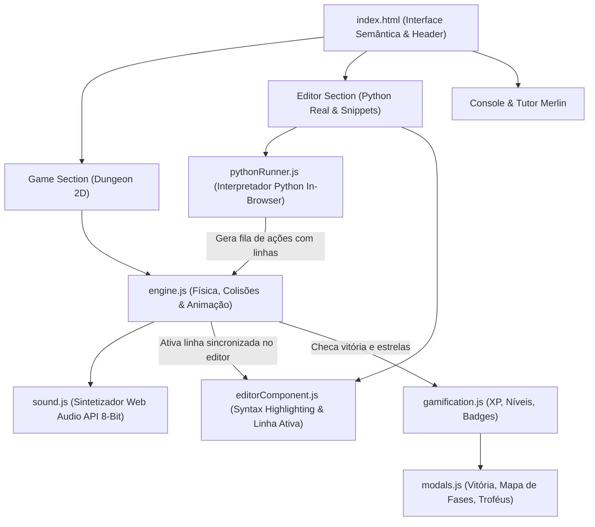

# ⚔️ MDev CodeQuest: A Masmorra do Código
> **Plataforma Gamificada de Aprendizado de Programação em Python para Crianças e Jovens**


---

## 🎮 O Conceito do Jogo

O **MDev CodeQuest** transforma o aprendizado de lógica e programação em uma jornada de aventura em masmorras 2D. Em vez de ler livros teóricos ou fazer exercícios abstratos, o aluno assume o papel de um Herói Mago e **escreve feitiços reais em Python** para se movimentar pelo tabuleiro, desviar de lava, coletar cristais mágicos, abrir portas trancadas com chaves e derrotar monstros com loops e condicionais!

---

## 🏰 Novos Elementos Gráficos & Props 3D Adicionados

A masmorra agora conta com um ecossistema visual de alta fidelidade:

> [!NOTE]
> **Transição da Landing Page para o Jogo:**
> A Landing Page agora funciona como um overlay em tela cheia com inicialização resiliente e handlers diretos `onclick="window.launchGameNow()"`. Clicar em qualquer um dos 3 botões ("Entrar na Masmorra", "Iniciar Aventura" ou no banner final) agora abre o jogo instantaneamente sem atrasos.
2. **Círculos Mágicos de Invocação:**
   - Círculo de glifos e runas arcanas ciano sob o herói no bloco de partida.
   - Círculo mágico violeta pulsante com rotação orbital sob o Portal Dimensional.
3. **Livro de Feitiços Flutuante (Grimório do Herói):**
   - Um livro místico com capa roxa de couro e gema reluzente que flutua e oscila suavemente ao lado do Mago.
4. **Adereços de Cenário Medievais:**
   - Barris de carvalho com aros de ferro forjado e caixotes de madeira reforçados nos cantos.
   - Estandarte real vermelho carmesim e dourado pendurado na parede de pedra norte.
5. **Efeitos Visuais de Feitiço (VFX Shockwave):**
   - Ao executar `heroi.atacar()` / `hero.attack()`, uma onda de choque mágica brilhante em anel se expande no chão com efeito Bloom!
6. **Controle de Câmeras Pré-definidas:**
   - **`🎥 Isométrica`**: Visão cinematográfica em ângulo 3D.
   - **`👁️ Top-Down`**: Visão ortogonal de cima, ideal para planejamento tático das coordenadas!

---

## 🌟 Landing Page de Boas-Vindas e Tutorial de Entrada

Antes de entrar na masmorra 3D, o aluno agora passa por uma **Landing Page imersiva** que ensina os conceitos essenciais da programação de forma amigável:

1. **Configuração Inicial do Aventureiro:**
   - O aluno digita seu **Nome de Jogador** (ex: *"Mago Gabriel"*).
   - Escolhe seu **Personagem Inicial** (🧙‍♂️ Mago, 🧙‍♀️ Feiticeira, ⚔️ Cavaleiro ou 🤖 Robô).
   - Clica no botão épico **"⚔️ INICIAR AVENTURA NA MASMORRA!"**.

2. **O que é Programar? (3 Passos Mágicos):**
   - **Passo 1:** Você escreve o feitiço no livro de códigos.
   - **Passo 2:** O computador lê e lança cada instrução em ordem.
   - **Passo 3:** O herói salta, anda, coleta gemas e derrota monstros em 3D!

3. **Suporte Bilíngue Nativo (🇧🇷 Português ⇄ 🇺🇸 English):**
   - O aluno pode alternar o idioma do código com 1 clique tanto na Landing Page quanto na barra do Editor!
   - **Português:** `heroi.andar_direita()`, `heroi.coletar()`, `heroi.atacar()`, `heroi.tem_inimigo()`.
   - **English:** `hero.move_right()`, `hero.collect()`, `hero.attack()`, `hero.has_enemy()`.
   - O interpretador aceita **ambos os idiomas simultaneamente** (incluindo `snake_case` e `camelCase`), permitindo uma transição suave da língua materna para o inglês de mercado!

4. **Grimório dos Comandos Básicos:**
   - **Movimentos:** `heroi.andar_direita()`, `heroi.andar_esquerda()`, `heroi.andar_cima()`, `heroi.andar_baixo()`.
   - **Ações:** `heroi.coletar()`, `heroi.atacar()`, `heroi.abrir_porta()`.
   - **Laços (`for`):** Comparação visual mostrando como repetir 4 passos em 2 linhas elegantes!
   - **Decisões (`if / else`):** Explicando como ensinar o herói a pensar antes de agir.

4. **Botão "🏠 Guia & Início":**
   - Presente no topo do jogo para que o aluno possa voltar à Landing Page e revisar os comandos a qualquer momento com 1 clique!

---

## 🚀 Como Executar Localmente

O servidor de desenvolvimento Vite já está configurado e rodando:

```bash
# Caso queira rodar manualmente no terminal:
cd "/Users/mateuszeca/Documents/mdev-plataforma-jogando"
npm run dev
```

> [!TIP]
> **Acesso no Navegador:**
> Abra no seu navegador o endereço: **`http://localhost:5173`** para jogar e testar a plataforma completa agora mesmo!

Os arquivos também foram espelhados na sua pasta do Google Drive:
`Documentos/mdev - plataforma de aprendizado de programacao /`

---

## 🏰 Arquitetura e Módulos da Plataforma



---

## 🗺️ Trilha Pedagógica das 8 Fases Iniciais

| Fase | Mundo | Conceito de Programação | Desafio Prático na Masmorra |
| :--- | :--- | :--- | :--- |
| **Fase 1: O Despertar do Herói** | 1. Primeiros Passos | Algoritmos e Sequenciamento | Andar 2 passos, coletar a primeira gema de mana e entrar no portal. |
| **Fase 2: O Lago de Lava** | 1. Primeiros Passos | Coordenadas e Desvios | Desviar de poças de fogo fervente usando comandos para baixo e cima. |
| **Fase 3: A Chave e a Porta** | 1. Primeiros Passos | Pré-requisitos & Operações | Encontrar a chave dourada (`heroi.coletar()`) e abrir a porta com `heroi.abrir_porta()`. |
| **Fase 4: A Ponte dos Laços** | 2. Floresta dos Laços | Laço `for i in range(N):` | Atravessar uma ponte de 6 blocos em no máximo 4 linhas de código. |
| **Fase 5: O Pomar de Cristais** | 2. Floresta dos Laços | Blocos de Ações Repetitivas | Coletar 4 cristais alinhados repetindo andar e coletar dentro do loop. |
| **Fase 6: O Corredor Sem Fim** | 2. Floresta dos Laços | Laço `while heroi.caminho_livre():` | Avançar automaticamente até encontrar a parede de pedra. |
| **Fase 7: O Guardião Slime** | 3. Templo das Decisões | Condicional `if / else` | Detectar monstros à frente e desferir ataque de espada (`heroi.atacar()`). |
| **Fase 8: A Prova do Mestre** | 3. Templo das Decisões | Integração Completa | Coletar gemas, desviar da lava e derrotar o Golem Boss para graduar-se! |

---

## ✨ Recursos Especiais para Crianças & Jovens

1. **Paleta de Feitiços Prontos**:
   - Crianças pequenas ou alunos em tablets podem clicar em blocos como `[+ heroi.andar_direita()]`, `[+ for i in range(3):]` para inserir o código pronto com a indentação correta de 4 espaços!
2. **Execução Sincronizada com Linha Ativa**:
   - Quando o herói dá um passo, a linha exata no editor brilha em dourado. Isso elimina a barreira abstrata entre o texto digitado e a ação visual.
3. **Controle de Velocidade e Passo a Passo**:
   - Botões de velocidade `⚡ 1x`, `⚡ 2x`, `⚡ 4x` e modo `⏭ Passo a Passo` para debugar com facilidade.
4. **Tutor Virtual Merlin**:
   - Mensagens amigáveis e carinhosas em português explicam os erros (ex: *"Psiu! Faltou colocar os dois pontos ':' no final do seu loop!"*).
5. **Efeitos Sonoros Retrô via Web Audio API**:
   - Sem arquivos pesados de mp3: sons de passos, gemas cintilantes, ataques, choques cômicos e fanfarra de vitória gerados em tempo real por osciladores.
6. **Sistema de Gamificação Completo**:
   - Barra de XP progressiva, níveis de aprendiz a arquimago, contador de sequência diária (streak 🔥), 8 troféus colecionáveis e seletor de personagens (Mago, Feiticeira, Cavaleiro e Robô).
